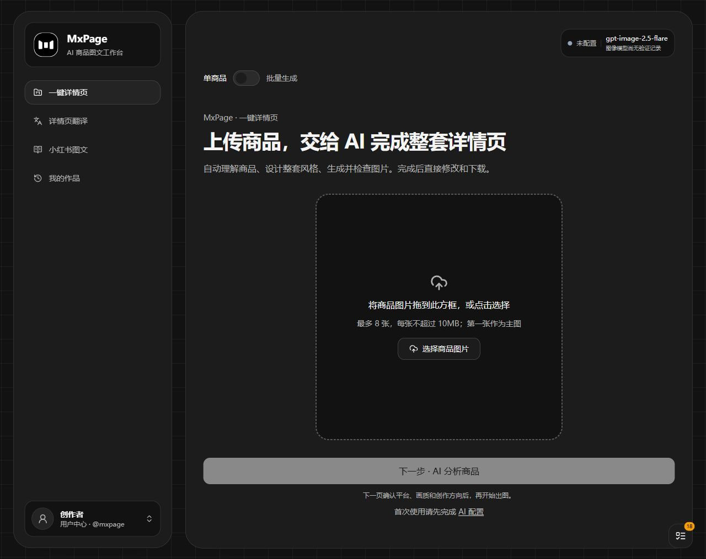
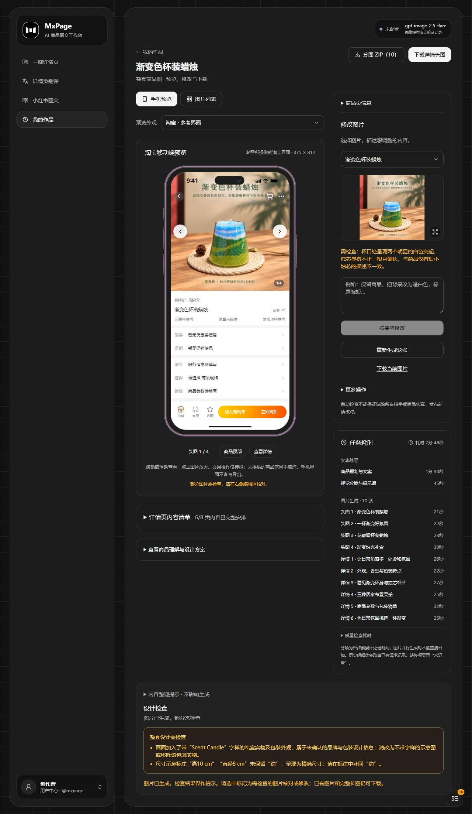

# MxPage · AI 电商详情页与商品图工作台

[简体中文](README.md) · [English](README.en.md) · [桌面版下载](https://github.com/ziguishian/MxPage/releases/latest) · [更新说明](docs/releases/v0.3.1.md) · [AI 文档索引](llms.txt)

[](https://github.com/ziguishian/MxPage/releases/latest)
[](LICENSE)
[](https://github.com/ziguishian/MxPage)
[](https://github.com/ziguishian/MxPage/actions/workflows/desktop-release.yml)

**MxPage 是由灵矩绘境维护的开源 AI 电商图片工作台。** 上传商品参考图，补充商品事实，选择平台、语言与图片数量，即可制作商品主图、完整详情页长图和小红书图文，也可以批量翻译已有商品图片。支持本地部署及 Windows、macOS 桌面运行。

**适合电商运营、跨境卖家、设计师和自部署团队。** 商品参考图 → 内容与分镜 → 生成/编辑 → 多语言译图 → ZIP 或详情长图。源码采用 MIT 许可，模型调用使用自己的 API 账号并单独计费。

[下载 Windows / macOS 版](https://github.com/ziguishian/MxPage/releases/latest) · [查看真实案例](docs/examples/README.md) · [源码运行](#源码运行) · [常见问题](#常见问题) · [English guide](README.en.md)

| 你想完成什么 | 从哪里开始 | 得到什么 |
| --- | --- | --- |
| 制作商品主图和详情页 | 一键详情页，上传参考图和已知事实 | 主图、详情分屏、ZIP 与详情长图 |
| 批量处理多个商品 | 一键详情页 → 批量生成，按文件夹分组 | 每个商品独立作品与任务进度 |
| 翻译已有电商图片 | 详情页翻译，上传图片并选语言 | 译图、原图对照及下载文件 |
| 制作小红书图文 | 小红书图文，描述主题和张数 | 1–8 张竖版配图、标题、正文与标签 |
| 用对话组织任务、处理文件 | Agent 工作台，确认执行方案 | 工具执行进度、可预览下载的成果 |

详情页使用 **V4 确定性工作流**，Agent 工作台使用独立的 **LangGraph.js + Deep Agents** 工具循环。恢复规则、支持范围与实测记录见[发布说明](docs/releases/v0.3.1.md)、[模型兼容](docs/provider-compatibility.md)及[验收记录](docs/provider-live-acceptance.md)。仓库 `main` 的新功能可能尚未打包进最新 Release，安装包以对应版本说明为准。

## 主要功能

稳定性优化：任务记录区分失败、结果未确认和待查询；新单图/编辑/小红书异步任务支持查询原结果。图像选项按已知模型能力限制并标注证据；Agent 可设金额预算，区分实报、估算与未知费用。日志尾读与空闲轮询已优化。详见 [优化与验收范围](docs/optimization-acceptance.md)，自动回归使用模拟接口；另获授权的 CloseAI、EvoLink 真实调用覆盖单商品、批量详情、编辑、整套与独立翻译、小红书及 Agent 文件导出，具体模型和边界见[真实验收记录](docs/provider-live-acceptance.md)。

新增 **[Agent 工作台](docs/agent-workspace.md)**（`/agent`）：LangGraph.js + Deep Agents 通用对话、确认后执行的研究/文件/电商工具、会话与检查点、流式进度、成果预览和下载。设置在 `/settings/agent`，原一键详情页继续保留，V4 固定流程与新 Agent 独立。

桌面控制已接入 Windows/macOS 驱动但默认关闭：Windows 输入保存链路尚未通过焦点检查，两个 macOS 目标未实测，均不标记已验收。详见 [Agent 使用与验收说明](docs/agent-workspace.md)。

| 场景 | 功能 |
| --- | --- |
| 电商详情页 | 商品识别、购买价值规划、整套分镜、主图与详情图生成、手机样机预览 |
| 完整内容策划 | 需求与痛点、卖点与证据、场景、已知参数、使用说明和购买决策信息；未知事实先确认 |
| 多平台视觉 | 通用电商、淘宝/天猫、拼多多、抖音和小红书提示词，按类目与任务应用 |
| 批量处理 | 文件夹商品批次、全局任务队列、逐张保存、失败查看和继续操作 |
| 图片翻译 | 单张、多张、文件夹、多语言批量；独立进度与预览页，上传支持刷新续传和请求防重复，每套每种语言只保存一份结果；旧重复原图作品隐藏但保留原图对照；固定提示词，不运行商品规划 Agent |
| 编辑与交付 | 逐图编辑、历史版本、原图/译图对照、分图 ZIP、完整详情长图 |
| 监控 | 当前阶段、文本及每张图片耗时、API 费用与稳定性图表、人民币费用估算 |
| 用户中心 | 头像与用户名、最近 12 个月消耗热力图、模型配置、外观与关于页面 |

详情任务支持 **0–10 张头图、0–20 张详情图，两项不能同时为 0**。平台预设用于内容与视觉制作，不会自动发布到平台，也不导出商城网站。

## 软件截图

以下为 **2026-10-17 本地运行的 v0.3.0** 实际截图，仅展示首页和效果页。效果页使用最新的渐变色杯装蜡烛作品，可查看手机预览、逐图编辑、文本与每张图片耗时。

**首页 · 上传商品开始创作**



<details>
<summary>效果页 · 手机预览、图片编辑与任务耗时（展开截图）</summary>



</details>

[查看两张完整截图与拍摄说明](docs/screenshots/README.md)

## 实际生成案例

以下图片来自本地已生成的作品，保留原始画面与文案；展示文件只做等比缩放、压缩和按页面顺序拼接。每组均提供**商品原图、全部头图、分屏详情图和完整详情长图**，点击案例可查看大图。

### 最新本地作品

| 渐变色杯装蜡烛 | 香薰炉 | 木纹外观桌面雾化器 |
| --- | --- | --- |
| [](docs/examples/gradient-candle/README.md) | [](docs/examples/aroma-burner/README.md) | [](docs/examples/wood-diffuser/README.md) |
| 4 张头图 + 6 屏详情 | 4 张头图 + 6 屏详情 | 3 张头图 + 4 屏详情 |
| [完整长图 · 1080 × 8640](docs/examples/gradient-candle/detail-long.jpg) | [完整长图 · 1080 × 8640](docs/examples/aroma-burner/detail-long.jpg) | [完整长图 · 1080 × 5760](docs/examples/wood-diffuser/detail-long.jpg) |

**渐变蜡烛 · 6 屏详情概览**

[](docs/examples/gradient-candle/detail-long.jpg)

**香薰炉 · 6 屏详情概览**

[](docs/examples/aroma-burner/detail-long.jpg)

**木纹雾化器 · 4 屏详情概览**

[](docs/examples/wood-diffuser/detail-long.jpg)

这三组作品使用 `gpt-6-luna` 与 `gpt-image-2.5-flare`，请求画质为 `auto`。记录保留 `PARTIAL` 质检状态；部分规格来自用户选中的模型候选，属于演示输入，不能作为实测商品参数。案例页保留具体来源和待核对项。

### 茶器与马克杯长图

| 金棕纹理带盖茶器 | 马克杯 · 完整内容重测 | 马克杯 · Round2 |
| --- | --- | --- |
| [](docs/examples/tea-set/README.md) | [](docs/examples/mug-complete/README.md) | [](docs/examples/mug-round2/README.md) |
| 3 张头图 + 8 屏详情 | 3 张头图 + 8 屏详情 | 3 张头图 + 4 屏详情 |
| [完整长图 · 1080 × 11520](docs/examples/tea-set/detail-long.jpg) | [完整长图 · 1080 × 11520](docs/examples/mug-complete/detail-long.jpg) | [完整长图 · 1080 × 5760](docs/examples/mug-round2/detail-long.jpg) |

<details>
<summary>展开茶器与马克杯的详情页概览</summary>

**茶器 · 8 屏：需求、外观卖点、纹理、结构、场景、搭配、已知信息与收尾。**

[](docs/examples/tea-set/detail-long.jpg)

**马克杯完整重测 · 8 屏：沿用暖木与奶油棕风格，展开正文、局部说明、场景和信息表。**

[](docs/examples/mug-complete/detail-long.jpg)

**马克杯 Round2 · 4 屏：保留早期场景与配色版本，便于比较内容展开前后的差异。**

[](docs/examples/mug-round2/detail-long.jpg)

</details>

这三组实测使用 `gpt-6-luna` 与 `gpt-image-2.5-flare` 的 `low` 画质。它们展示实际输出，不代表全部通过商品一致性或文案验收。[全部案例、原图与来源说明](docs/examples/README.md)。

## 下载与首次使用

在 [GitHub Releases](https://github.com/ziguishian/MxPage/releases/latest) 选择对应系统：

| 系统 | v0.3.1 文件 | 使用方式 |
| --- | --- | --- |
| Windows x64 | `MxPage-0.3.1-windows-x64.zip` | 完整解压后运行 `MxPage.exe` |
| macOS Apple Silicon | `MxPage-0.3.1-macos-arm64.zip` | 解压打开 `MxPage.app`，也可移到“应用程序” |
| macOS Intel | `MxPage-0.3.1-macos-x64.zip` | 解压打开 `MxPage.app`，也可移到“应用程序” |

绿色包包含 Electron 和本地服务，**无需安装 Node.js**。不要单独复制 EXE 或移动 `.app` 内部文件。免安装不代表数据跟随程序目录移动：

- Windows 数据：`%APPDATA%/MxPage/`。
- macOS 数据：`~/Library/Application Support/MxPage/`。
- 更新前退出应用、备份数据目录，再替换程序文件。
- 包没有商业代码签名或 Apple 公证；macOS 使用 ad-hoc 签名。系统可能要求确认来源，Release 提供 `SHA256SUMS.txt` 校验文件。

首次运行：

1. 左下角头像 → **API 配置**，填写自己的 OpenAI 兼容服务地址与 API Key。
2. 使用探测入口发现模型并检查连接；只需更新目录时，点击“仅刷新模型列表”，不会发送文本、识图或生图请求。列表以当前密钥返回结果为准，服务商价格页不代表该密钥的模型权限。右上角显示连接状态、图像模型及最近验证时间。
3. 模型选择自动保存，新任务按文本、识图、生成和编辑角色使用已选模型；已有任务保留原设置，不自动换模。模型 ID 来自服务发现结果。文本与识图优先官方 Responses，自动识别中转站的协议和 JSON 格式，无需手动配置兼容模式；正式请求失败不隐式重发。详见[中转站兼容说明](docs/provider-compatibility.md)。
4. 上传参考图和已知商品事实。补充信息逐题弹窗，提供三个具体候选和自行填写；候选须由用户确认，未知尺寸不自动视为实测值。规格表支持题目中统一声明单位；候选校验失败会显示具体原因，已有有效候选无需重新生成。
5. 先用少量图片、`low` 质量验证费用与效果，再扩大规模。API Key、额度和模型费用由用户自行提供。

图像质量、尺寸、格式和背景等参数按所选模型能力调整；发现模型不等于已经实测网关支持所有参数。

主图和详情图均可选 0，只生成另一类图片；两项不能同时为 0。单商品、批量和 Agent 共用此校验，保存、重新打开及重新生成保留 0。

CloseAI 根地址的新原生协议检查自动使用文档规定的 `/anthropic`、`/google` 前缀，并保存到缓存与任务快照；旧路径保留。GPT Image 继续使用标准 `/v1/images`，目录是否包含模型仍以当前密钥返回为准。

模型列表返回 401 表示服务商未接受当前密钥，403 表示访问被拒绝；本地缺少密钥会单独提示且不发送上游请求。刷新或保存失败保留原浏览器凭据，更换服务地址不复用上一服务的密钥。可用“仅刷新模型列表”检查目录访问，无需调用模型。

商品识别等业务操作缺少浏览器密钥时返回明确的配置提示（400），不再显示笼统的 500；商品配置页提供密钥配置入口。不同浏览器、设备及 `localhost` / `127.0.0.1` 地址的浏览器存储互不共享。

模型目录中的 Gemini Image / Nano Banana 支持以图片加指令进行编辑，因此可用于图像编辑和翻译；这不代表支持蒙版修补。能力识别保留服务商原始模型 ID，不补造目录中缺失的模型。

小红书任务独立解析 1–8 张竖版配图数量（未指定时为 5 张），要求中可写“8 张”或“8 页”，“第一张”“最后一页”等页序描述不会当成总数量。启动失败原因持续显示，修正后可继续原项目；标题、正文与标签随检查点保存。Agent 文档工具返回可下载的成果链接，旧回复中的本会话文件路径也会映射到对应下载入口。

小红书新任务内置编辑式信息图、深色系统杂志、摄影生活杂志、留白知识手册和温暖线描故事五类排版提示词，按主题选择，用户指定风格优先。规划阶段控制每页内容密度，分镜阶段统一配色、字体、边距，并为封面、流程、对比等内容安排不同构图；不增加模型调用步骤。规则随任务保存，旧任务继续使用原提示词。结果以缩略图总览展示，点击进入大图画廊，支持方向键翻页、缩略图跳页、原尺寸查看、单页下载及 ZIP 下载；检查提醒对应当前图片版本。

文本与识图自动兼容 Responses、Chat Completions、Anthropic Messages 和 Gemini 原生接口，用户无需选择协议。图像保留标准 Images 与既有 Gemini 路径，并按 EvoLink 官方参数描述支持 GPT Image、Seedream、Nano Banana、Qwen Image 等系列的异步接口。已成功的调用方式优先保留，新任务保存各模型协议及参数快照；刷新模型列表不丢失兼容记录。详情页和批量翻译保存上游任务编号，查询中断后继续只查询原任务。业务失败不换接口重发。专用操作和未描述的私有接口仍有支持边界，详见[兼容说明](docs/provider-compatibility.md)。自动回归使用模拟上游；另行真实调用仅覆盖[验收记录](docs/provider-live-acceptance.md)列出的模型和操作。

## V4 工作流

```text
PREPARE → PLAN → WAITING_INPUT（需要确认时）→ ART_DIRECTION
        → WAITING_PROMPTS（预览、修改并确认每页提示词）
        → GENERATE → IMAGE_REVIEW → SET_REVIEW
        → COMPLETED / PARTIAL / FAILED
```

- **生成前确认**：新建单商品和批量详情任务在分镜完成后暂停，所有图片的实际生图提示词在同一页展开。可连续修改、统一保存和确认，确认后才生图；刷新、停止和继续保留已保存的修改。重复确认不重复派发，旧任务维持原恢复方式，小红书流程不受影响。
- **程序调度**：模型返回规划和分镜 JSON；首张 HERO 完成后处理其余图片，并发上限为 2。
- **本地排版**：以 `textBlocks[].text` 为正文来源，自动同步换行，保留参数、数字、单位和表格；自然润色不触发整套重做。
- **按检查点继续**：复用完成的规划、分镜、图片和检查；请求前记录 ID，心跳租约防止重复执行者覆盖状态。
- **不确定请求不自动重试**：超时、断网、无效响应可能已经计费，需用户明确授权重试。停止阻止后续调度，已发出的请求收尾并保存结果。
- **质检保留图片**：发现问题或检查未完成时保留图片并提示复核，不自动付费重画；用户明确修改后再执行编辑。
- **大套图分组检查**：12 张以内一次整套检查，更多图片使用重叠分组，已完成组可恢复复用。

补充选项、手动编辑、明确重试和大套图分组会增加调用次数。详见 [V4 恢复与可靠性](docs/workflow-v4-reliability.md)。

商品规划等待完整响应的上限为 180 秒；HTTP 200 或流开始不代表规划已完成。超时会暂停并保留不确定请求，需在任务详情明确重试，不自动重新提交。

## 源码运行

需要 Git、**Node.js 24** 和 npm。

```bash
git clone https://github.com/ziguishian/MxPage.git
cd MxPage
npm ci
```

复制 `.env.example` 为 `.env`：PowerShell 使用 `Copy-Item .env.example .env`，macOS/Linux 使用 `cp .env.example .env`。设置自己的 `APP_SECRET` 后执行：

```bash
npm run prisma:generate
npm run prisma:migrate
npm run docs:sync
npm run dev
```

访问 `http://localhost:3000`。默认数据库位于 `prisma/dev.db`，图片和日志位于 `storage/`。生产运行使用 `npm run build`、`npm start`；先停止占用同一 `.next` 的开发服务。桌面构建使用独立 `.next-desktop`。

重复执行启动命令会复用同项目的服务；其他程序占用端口时明确报错，不自动换端口、不清理缓存。默认监听 `127.0.0.1:3000`，可显式传入 `--hostname` / `--port`。翻译上传断点保存在当前浏览器的 IndexedDB 中，清除站点数据会移除尚未提交的本地草稿。

| 配置 | 用途 |
| --- | --- |
| `DATABASE_URL` | SQLite 文件位置 |
| `STORAGE_ROOT` | 图片、资产和监控记录目录 |
| `APP_SECRET` | 本地应用密钥，真实值不要提交 |
| `LOCK_BASE_URL` | 私有部署的固定模型网关，也兼容旧变量别名 |
| `NEXT_PUBLIC_SITE_URL` | 可选公开域名，仅用于品牌元数据；不会将工作区变成公开官网，本地使用留空 |

这是个人本地工作台，公网共享前需配置访问控制、TLS 和数据隔离。`robots.txt` / `noindex` 是搜索提示，不是访问权限控制。

## 开发、测试与打包

```bash
npm test                 # 隔离数据库与模拟 Provider，不调用付费模型
npm run test:detail      # 工作流、恢复和排版重点测试
npm run typecheck
npm run build:desktop
npm run dist:green       # Windows 本机打包 x64 ZIP
npm run dist:mac         # macOS 本机打包当前架构 ZIP
npm run smoke:desktop   # 包内 SQLite、Prisma、sharp 与页面冒烟验证
```

[发布流水线](.github/workflows/desktop-release.yml)在原生 Windows、macOS ARM64、macOS Intel 环境构建并验证后，发布三个 ZIP 与 SHA256 校验文件。开发者数据库、密钥、测试输出和生成报告不进入发布包。

```text
app/                    页面与 API
components/             编辑器、手机预览、设置、监控和队列
lib/detail-runs/        V4 状态机、请求账本、检查点、租约和排版
lib/translation/        独立固定提示词翻译
lib/ai/                 Provider 适配与场景提示词
lib/monitor/            用量、计费、热力图和耗时
prisma/                 数据模型与迁移
desktop/                Electron 与本地服务启动
tests/                  隔离的单元及流程测试
```

代码助手应先读 [AGENTS.md](AGENTS.md)。[llms.txt](llms.txt) 是产品事实与文档索引，`npm run docs:sync` 同步到应用的 `/llms.txt`。历史设计文档继续保留，以当前代码、测试和 V4 文档为准。

## 费用、数据与限制

- 软件开源不代表模型免费。文本、图像生成、编辑、翻译与明确重试可能产生 Provider 费用。
- 监控区分接口金额、按用量估算、粗估和未计价记录。界面显示人民币，汇率和单价可编辑，不是实时结算账单。见[计费说明](docs/api-billing.md)。
- API Key 默认在当前浏览器本地存储，请求时传给本地服务，不存入项目数据库；桌面与普通浏览器的配置互相独立。
- 数据可保存在本地，但生成所需图片和描述会发送至配置的模型服务；不是完全离线生成器。
- 需人工核对商品外观、文案、翻译、参数和营销说法。选中的模拟候选保留来源记录，不能据此宣称实测、认证或未经核实的销售承诺。
- 旧工作流只保留查看/导出，不迁移到 V4；需要新流程请创建新任务。沿用现有 SQLite 模型和 API 路径。

## 常见问题

### MxPage 是免费的 AI 电商详情页生成器吗？

源码采用 MIT 许可，可以自行部署。AI 模型调用不免费赠送额度：商品识别、规划、生图、编辑和翻译可能由你配置的服务商收费。先用一张图片验证模型、费用和效果，再增加数量。[计费说明](docs/api-billing.md)。

### 能只生成商品主图，或者只生成详情图吗？

可以。详情任务支持 0–10 张主图和 0–20 张详情图，合计至少一张。小红书独立支持 1–8 张竖版配图，默认五张。

### 支持哪些模型服务？需要手动选协议吗？

填写服务地址与现有 API Key，发现模型并保存各角色默认值即可。文本/识图自动兼容 Responses、Chat Completions、Anthropic Messages 和 Gemini；图像支持标准 Images、Gemini 与已描述的 EvoLink 异步接口。平台支持某型号不代表当前密钥拥有权限；模型列表以目录返回为准。[兼容边界](docs/provider-compatibility.md)与[真实验收范围](docs/provider-live-acceptance.md)单独记录。

### 图片翻译会重新规划整套详情页吗？

不会。翻译使用独立的固定提示词流程，提供原图与译图对照。商品编辑、翻译和导出结果仍应人工核对，不能承诺像素完全一致或文案永不出错。[翻译流程](docs/translation-workflow.md)。

### 断线、超时后会重复扣费吗？

已完成步骤按检查点复用。已保存上游任务编号时继续查询原任务；结果不确定的请求不会自动重发，需明确处理后再继续。模型费用最终以服务商账单为准。[恢复规则](docs/workflow-v4-reliability.md)。

### 本地部署是否意味着图片完全不出电脑？

不是。作品和数据库可保存在本地，生成所需的图片与描述仍发送给你配置的模型服务。密钥保存在当前浏览器，请求时提供给本地服务；不同浏览器及 `localhost` / `127.0.0.1` 不共享该配置。缺少密钥时先到设置页填写，不要反复提交。

### 能自动发布到淘宝、小红书，或者直接控制电脑吗？

平台预设用于生成图片和文案，不自动发布到商家账号。Agent 桌面控制默认关闭，Windows/macOS 的真实 GUI 验收状态见[Agent 说明](docs/agent-workspace.md)；不能把驱动已接入当作该能力已验收。

## 文档与反馈

上传断点仅更新进度，原图在 IndexedDB 中只保存一次，兼容已有草稿。作品列表使用按需生成的 WebP 缩略图，原图、译图和导出保持原尺寸。运行 `npm run test:all` 可执行完整回归，见[浏览器回归](docs/browser-regression.md)。

设置 → 数据管理支持本地数据库与素材备份、校验预览后恢复缺失作品，以及回收站还原；恢复保留已有作品，不覆盖新修改。原图上传增加大小、格式与像素校验，详见[数据管理](docs/data-management.md)。

翻译结果完成后停止定时刷新，切回页面时同步一次；全局队列空闲时每 30 秒检查，页面隐藏时暂停。作品封面优先使用按页面顺序选中的译图或生成结果，尚未出图时使用原图，原图对照和历史素材保持可用。

[更新说明](docs/releases/v0.3.1.md) · [恢复与可靠性](docs/workflow-v4-reliability.md) · [批量翻译](docs/translation-workflow.md) · [任务队列](docs/global-task-queue.md) · [计费](docs/api-billing.md) · [案例](docs/examples/README.md) · [问题反馈](https://github.com/ziguishian/MxPage/issues)

反馈请附版本、复现步骤与脱敏错误，不要提交 API Key 或私人商品资料。

## 品牌与许可

**灵矩绘境 · MxPage（MatrixInspire）** · Copyright © 2026 灵矩绘境。源码采用 [MIT](LICENSE)；素材及生成结果仍需遵守各自的权利与模型服务条款。

### 交流社区


