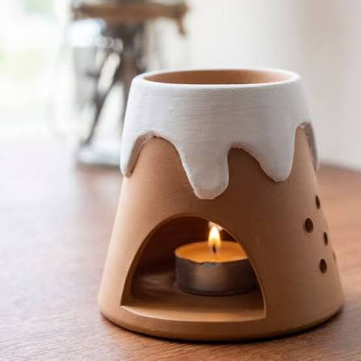
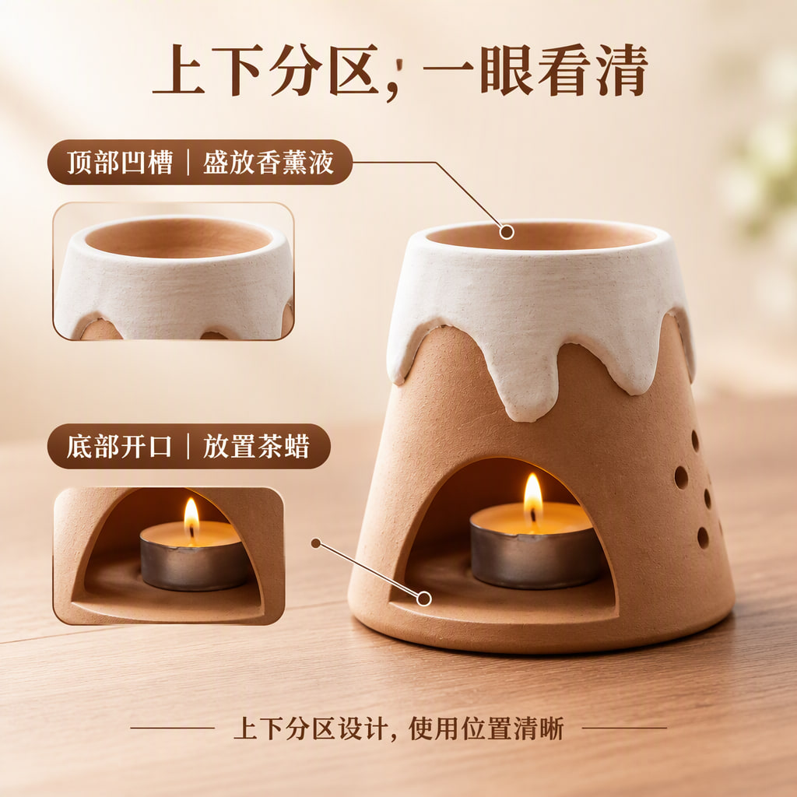
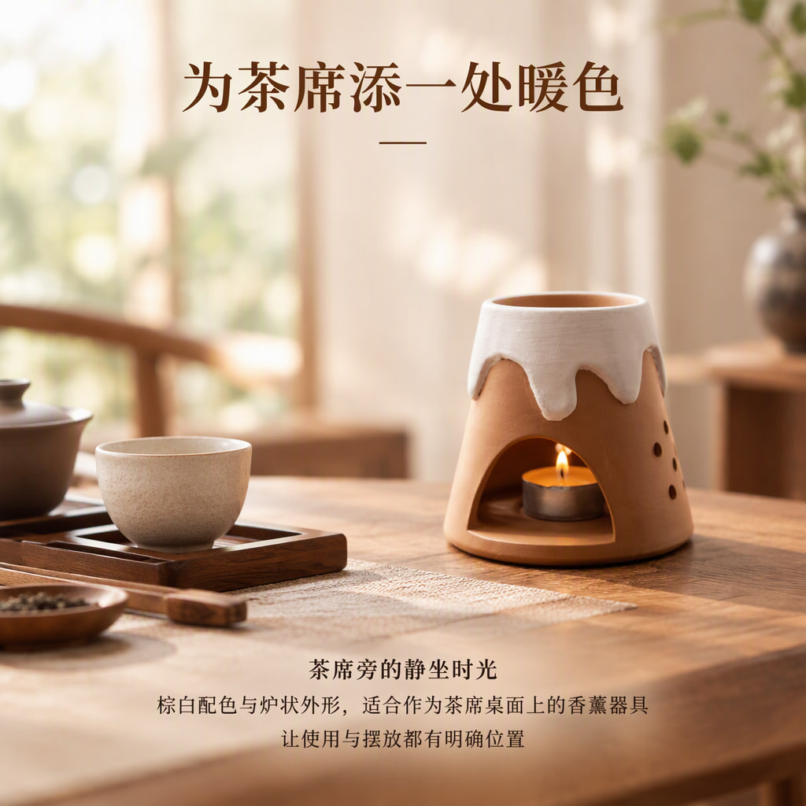
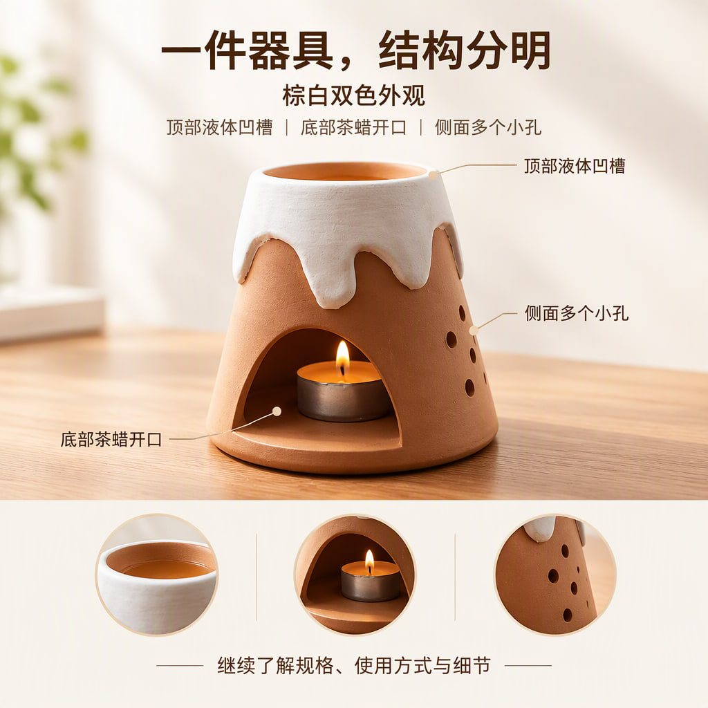
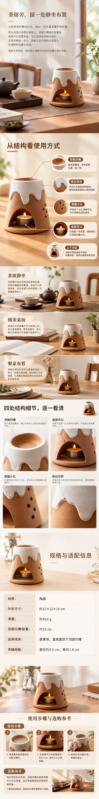

# 香薰炉

[全部案例](../README.md) · [仓库首页](../../../README.md) · [完整长图](detail-long.jpg)

最新本地生成作品。棕白双色香薰炉，以茶席、阅读桌面和餐桌为场景，结合结构说明、局部特写、规格表及使用步骤。

| 规划模型 | 图像模型 | 请求画质 | 头图 / 详情 | 长图尺寸 |
| --- | --- | --- | --- | --- |
| gpt-6-luna | gpt-image-2.5-flare | auto | 4 / 6 | 1080 × 8640 |

## 商品原图

## 全部头图

| 头图 1 | 头图 2 | 头图 3 | 头图 4 |
| --- | --- | --- | --- |
|  |  |  |  |

## 详情页概览

按从左到右、从上到下的顺序阅读。

## 完整详情长图

[打开完整尺寸长图](detail-long.jpg) · 所有详情屏均包含在下图，未拼入头图或手机样机。

## 逐屏查看

| 顺序 | 内容 | 文件 |
| --- | --- | --- |
| 1 | 茶席旁，留一处静坐布置 | [查看单屏](detail-1.jpg) |
| 2 | 从结构看使用方式 | [查看单屏](detail-2.jpg) |
| 3 | 三种桌面布置参考 | [查看单屏](detail-3.jpg) |
| 4 | 四处结构细节，逐一看清 | [查看单屏](detail-4.jpg) |
| 5 | 规格与适配信息 | [查看单屏](detail-5.jpg) |
| 6 | 使用步骤与选购参考 | [查看单屏](detail-6.jpg) |

## 来源与检查记录

从本地作品库以只读方式提取该项目当前图片版本（2026-10-17 生成），按编辑器详情顺序拼成长图。精简模型与检查记录见 [generation.json](generation.json)。完整数据库、配置和请求日志未包含在案例中。

记录状态为 PARTIAL。整套检查提示部分安全说明缺少确认，以及场景文案混入了编辑过程说明。尺寸、容量、材质及操作组合包含用户选择的模型推测候选；案例中的使用示意不替代实物说明书。

收录日期：2026-10-17。仅等比缩放、压缩与顺序拼接，没有重新生图、补字或局部修图。原图仅用于说明本次生成输入，不代表拥有图中品牌或素材的独占权利。
