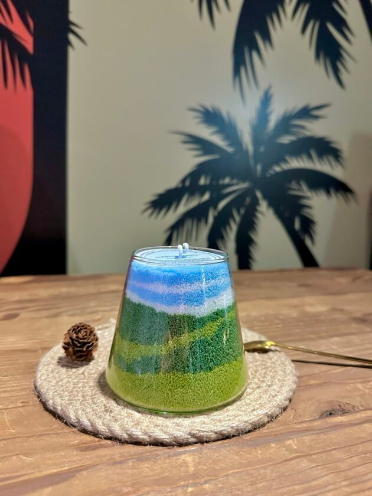
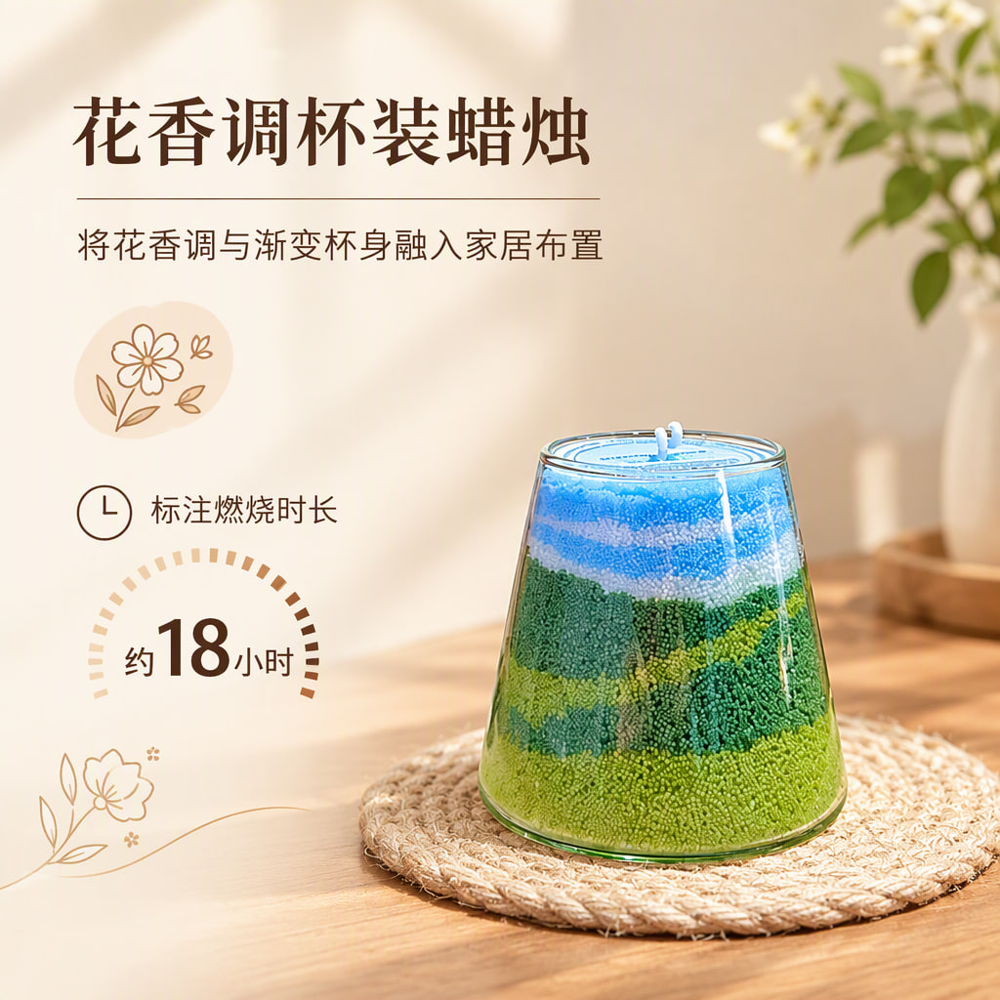
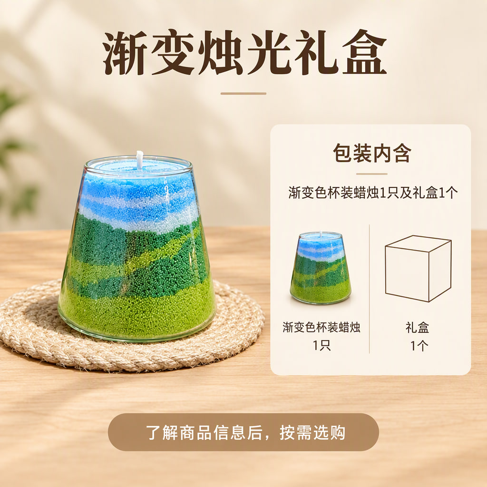
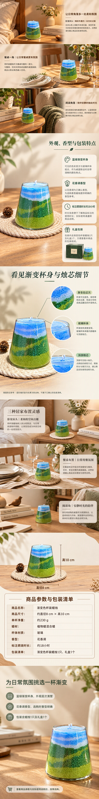

# 渐变色杯装蜡烛

[全部案例](../README.md) · [仓库首页](../../../README.md) · [完整长图](detail-long.jpg)

最新本地生成作品。蓝绿渐变杯体配合暖木与自然窗光，包含居家氛围、香型与包装、结构特写、三种场景、参数清单和收尾。

| 规划模型 | 图像模型 | 请求画质 | 头图 / 详情 | 长图尺寸 |
| --- | --- | --- | --- | --- |
| gpt-6-luna | gpt-image-2.5-flare | auto | 4 / 6 | 1080 × 8640 |

## 商品原图

## 全部头图

| 头图 1 | 头图 2 | 头图 3 | 头图 4 |
| --- | --- | --- | --- |
|  |  |  |  |

## 详情页概览

按从左到右、从上到下的顺序阅读。

## 完整详情长图

[打开完整尺寸长图](detail-long.jpg) · 所有详情屏均包含在下图，未拼入头图或手机样机。

## 逐屏查看

| 顺序 | 内容 | 文件 |
| --- | --- | --- |
| 1 | 让日常角落多一处柔和氛围 | [查看单屏](detail-1.jpg) |
| 2 | 外观、香型与包装特点 | [查看单屏](detail-2.jpg) |
| 3 | 看见渐变杯身与烛芯细节 | [查看单屏](detail-3.jpg) |
| 4 | 三种居家布置灵感 | [查看单屏](detail-4.jpg) |
| 5 | 商品参数与包装清单 | [查看单屏](detail-5.jpg) |
| 6 | 为日常氛围挑选一杯渐变 | [查看单屏](detail-6.jpg) |

## 来源与检查记录

从本地作品库以只读方式提取该项目当前图片版本（2026-10-17 生成），按编辑器详情顺序拼成长图。精简模型与检查记录见 [generation.json](generation.json)。完整数据库、配置和请求日志未包含在案例中。

记录状态为 PARTIAL。整套检查提示：包装图新增了未确认的礼盒字样，尺寸引线遗漏了“约”；首张头图另有烛芯数量与长度的检查提示。参数、香型、时长与包装来自用户选中的模型推测候选，并非实测资料。

收录日期：2026-10-17。仅等比缩放、压缩与顺序拼接，没有重新生图、补字或局部修图。原图仅用于说明本次生成输入，不代表拥有图中品牌或素材的独占权利。
