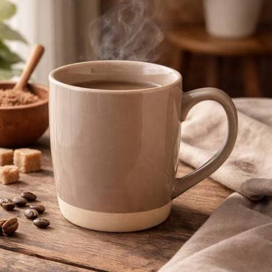
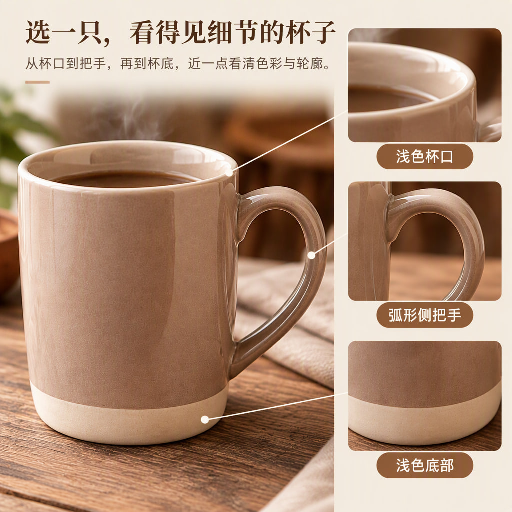

# 浅棕马克杯 · 完整内容重测

[全部案例](../README.md) · [仓库首页](../../../README.md) · [完整长图](detail-long.jpg)

沿用 Round1、Round2 的暖木、奶油棕与自然窗光，详情从 4 屏扩展到 8 屏。补充解释正文、五项外观理由、局部图、三种生活场景、信息表与收尾，不以减少文字代替内容策划。

| 规划模型 | 图像模型 | 请求画质 | 头图 / 详情 | 长图尺寸 |
| --- | --- | --- | --- | --- |
| gpt-6-luna | gpt-image-2.5-flare | low | 3 / 8 | 1080 × 11520 |

## 商品原图

## 全部头图

| 头图 1 | 头图 2 | 头图 3 |
| --- | --- | --- |
|  |  |  |

## 详情页概览

按从左到右、从上到下的顺序阅读。

## 完整详情长图

[打开完整尺寸长图](detail-long.jpg) · 所有详情屏均包含在下图，未拼入头图或手机样机。

## 逐屏查看

| 顺序 | 内容 | 文件 |
| --- | --- | --- |
| 1 | 日常需求 | [查看单屏](detail-1.jpg) |
| 2 | 五项外观理由 | [查看单屏](detail-2.jpg) |
| 3 | 杯口与配色 | [查看单屏](detail-3.jpg) |
| 4 | 把手与底部 | [查看单屏](detail-4.jpg) |
| 5 | 三种生活场景 | [查看单屏](detail-5.jpg) |
| 6 | 桌面搭配 | [查看单屏](detail-6.jpg) |
| 7 | 已知商品信息 | [查看单屏](detail-7.jpg) |
| 8 | 收尾引导 | [查看单屏](detail-8.jpg) |

## 来源与检查记录

来自 mug-complete-retest / round-6，模型、数量和状态核对自 comparison-data.json，观察记录来自 review-notes.json。与 Round2 使用同一张商品原图。

记录状态为 PARTIAL。11 张图片已生成；单图质检仅 4/11 返回，其余单图与整套质检超时。局部引线、小字可读性、把手连接及重复视角仍需核对；图片没有后期补字或自动重新生成。

收录日期：2026-10-17。仅等比缩放、压缩与顺序拼接，没有重新生图、补字或局部修图。原图仅用于说明本次生成输入，不代表拥有图中品牌或素材的独占权利。
