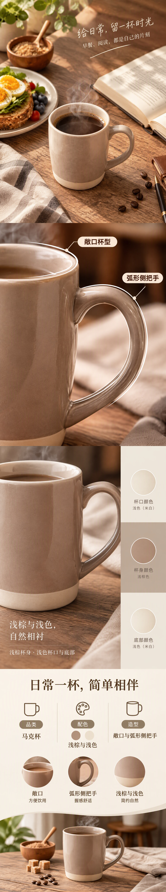

# 浅棕马克杯 · Round2

[全部案例](../README.md) · [仓库首页](../../../README.md) · [完整长图](detail-long.jpg)

保留五轮测试中用户偏好的 Round2 版本：暖木场景、奶油棕配色、俯视开篇、把手特写与配色信息页。可与完整内容重测对比阅读节奏和信息量。

| 规划模型 | 图像模型 | 请求画质 | 头图 / 详情 | 长图尺寸 |
| --- | --- | --- | --- | --- |
| gpt-6-luna | gpt-image-2.5-flare | low | 3 / 4 | 1080 × 5760 |

## 商品原图

## 全部头图

| 头图 1 | 头图 2 | 头图 3 |
| --- | --- | --- |
|  |  |  |

## 详情页概览

按从左到右、从上到下的顺序阅读。

## 完整详情长图

[打开完整尺寸长图](detail-long.jpg) · 所有详情屏均包含在下图，未拼入头图或手机样机。

## 逐屏查看

| 顺序 | 内容 | 文件 |
| --- | --- | --- |
| 1 | 日常场景 | [查看单屏](detail-1.jpg) |
| 2 | 杯口与把手特写 | [查看单屏](detail-2.jpg) |
| 3 | 配色信息 | [查看单屏](detail-3.jpg) |
| 4 | 商品信息收尾 | [查看单屏](detail-4.jpg) |

## 来源与检查记录

来自 mug-complete-retest / round-2，原始产物对应 mug-five-rounds 的 Round2；模型、数量和状态核对自 comparison-data.json。

记录状态为 PARTIAL，整套检查曾超时。早期成图包含未有资料支持的容量、材质或握感表达，保留原样用于效果对照，不作为可直接上架的商品事实。

收录日期：2026-10-17。仅等比缩放、压缩与顺序拼接，没有重新生图、补字或局部修图。原图仅用于说明本次生成输入，不代表拥有图中品牌或素材的独占权利。
