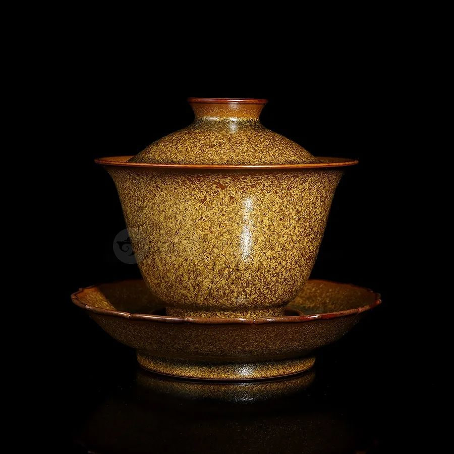
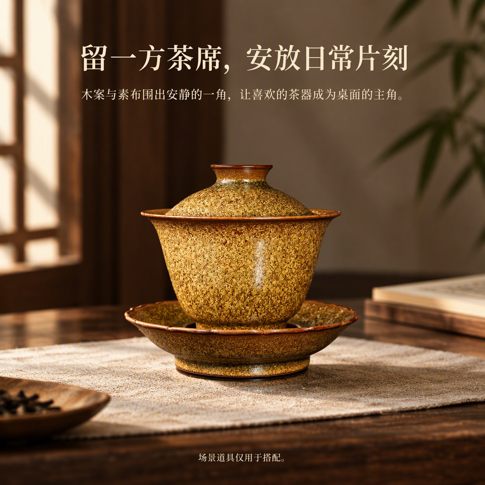
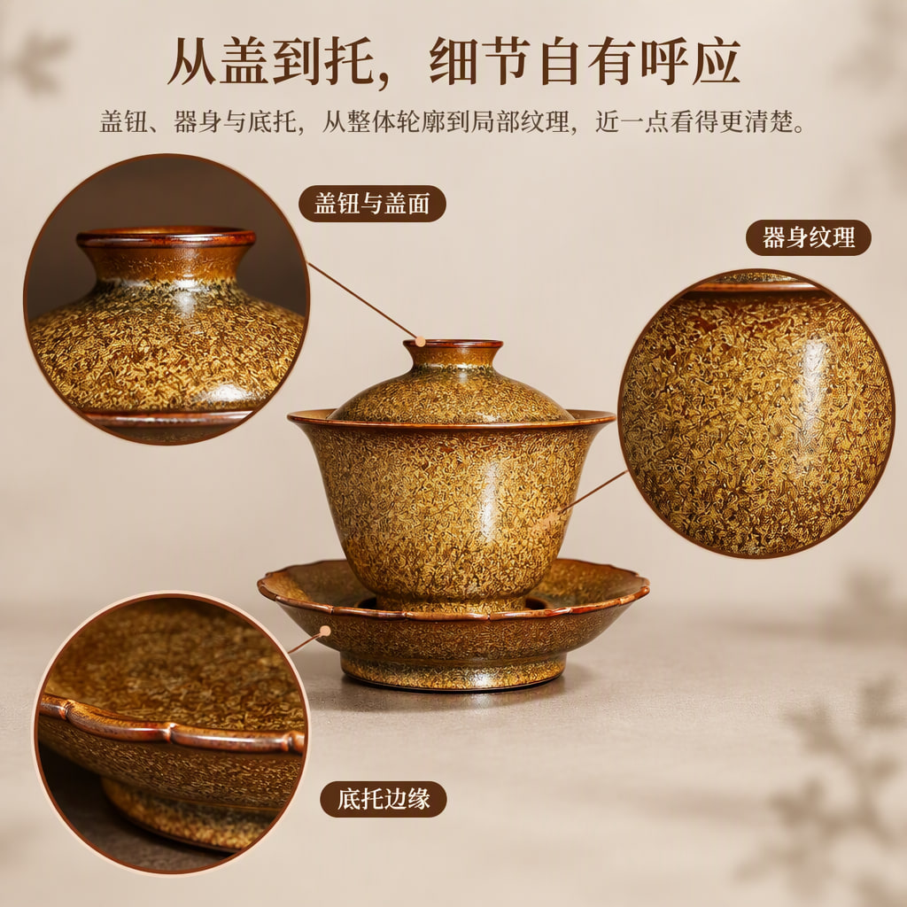

# 金棕纹理带盖茶器

[全部案例](../README.md) · [仓库首页](../../../README.md) · [完整长图](detail-long.jpg)

金棕、深木与暖灰的中式茶席风格，完整展开需求、外观卖点、纹理、结构、三种陈设场景、搭配方法、已知信息表与收尾。

| 规划模型 | 图像模型 | 请求画质 | 头图 / 详情 | 长图尺寸 |
| --- | --- | --- | --- | --- |
| gpt-6-luna | gpt-image-2.5-flare | low | 3 / 8 | 1080 × 11520 |

## 商品原图

## 全部头图

| 头图 1 | 头图 2 | 头图 3 |
| --- | --- | --- |
|  |  |  |

## 详情页概览

按从左到右、从上到下的顺序阅读。

## 完整详情长图

[打开完整尺寸长图](detail-long.jpg) · 所有详情屏均包含在下图，未拼入头图或手机样机。

## 逐屏查看

| 顺序 | 内容 | 文件 |
| --- | --- | --- |
| 1 | 把片刻，留在一方茶席 | [查看单屏](detail-1.jpg) |
| 2 | 这只茶器，值得细看的五处 | [查看单屏](detail-2.jpg) |
| 3 | 金棕之间，层次可见 | [查看单屏](detail-3.jpg) |
| 4 | 层层相衬，轮廓有序 | [查看单屏](detail-4.jpg) |
| 5 | 一器在席，三种日常 | [查看单屏](detail-5.jpg) |
| 6 | 让茶席，与器物相衬 | [查看单屏](detail-6.jpg) |
| 7 | 选购前，看清外观信息 | [查看单屏](detail-7.jpg) |
| 8 | 把喜欢的器物，放进日常 | [查看单屏](detail-8.jpg) |

## 来源与检查记录

来自 2026-10-16 的 tea-complete-test / round-1 实测报告，模型及状态核对自 test-record.json；保留当时的全部 11 张输出和已导出的长图。

记录状态为 PARTIAL。图片已全部生成，但部分纹理被强化成浮雕状，底足结构和引线落点与参考图存在差异；没有将容量、材质或尺寸补写为实测事实。

收录日期：2026-10-17。仅等比缩放、压缩与顺序拼接，没有重新生图、补字或局部修图。原图仅用于说明本次生成输入，不代表拥有图中品牌或素材的独占权利。
