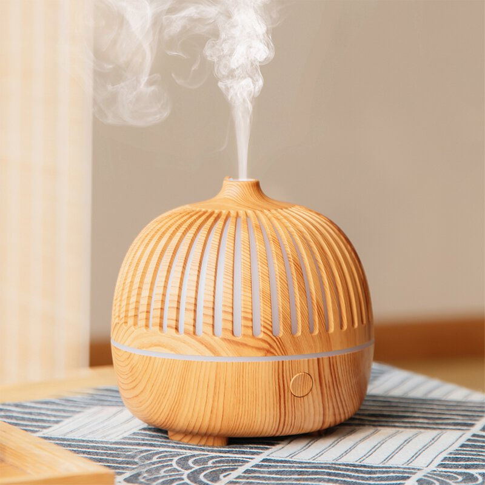
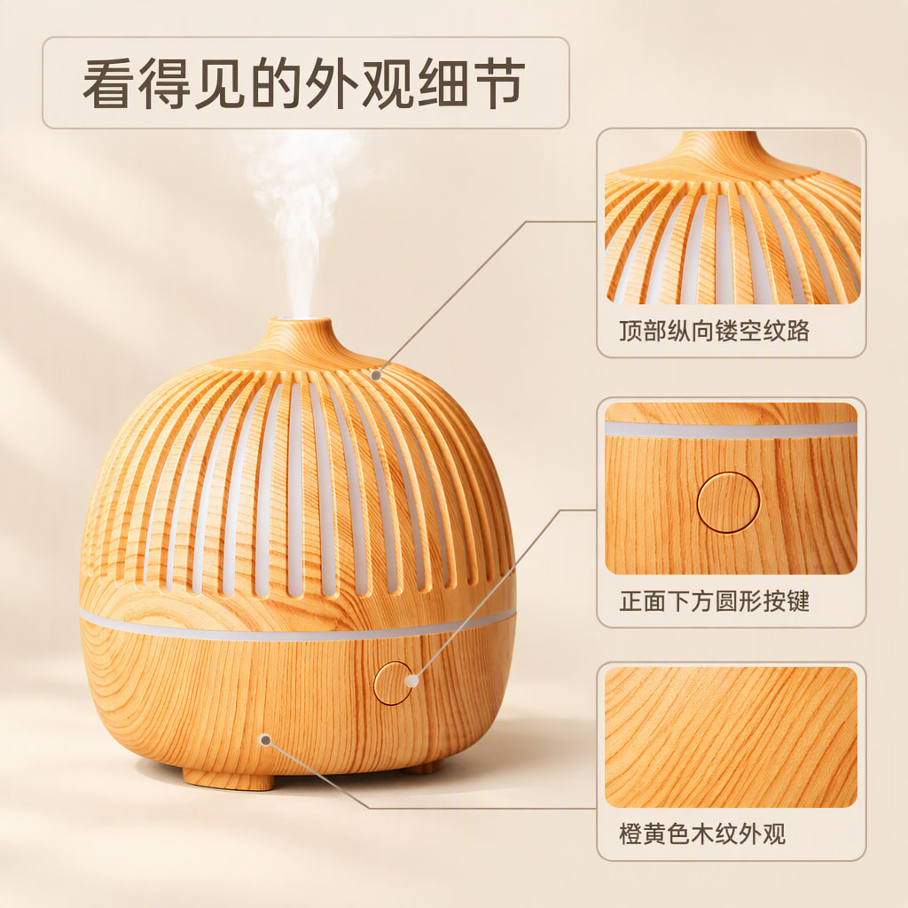
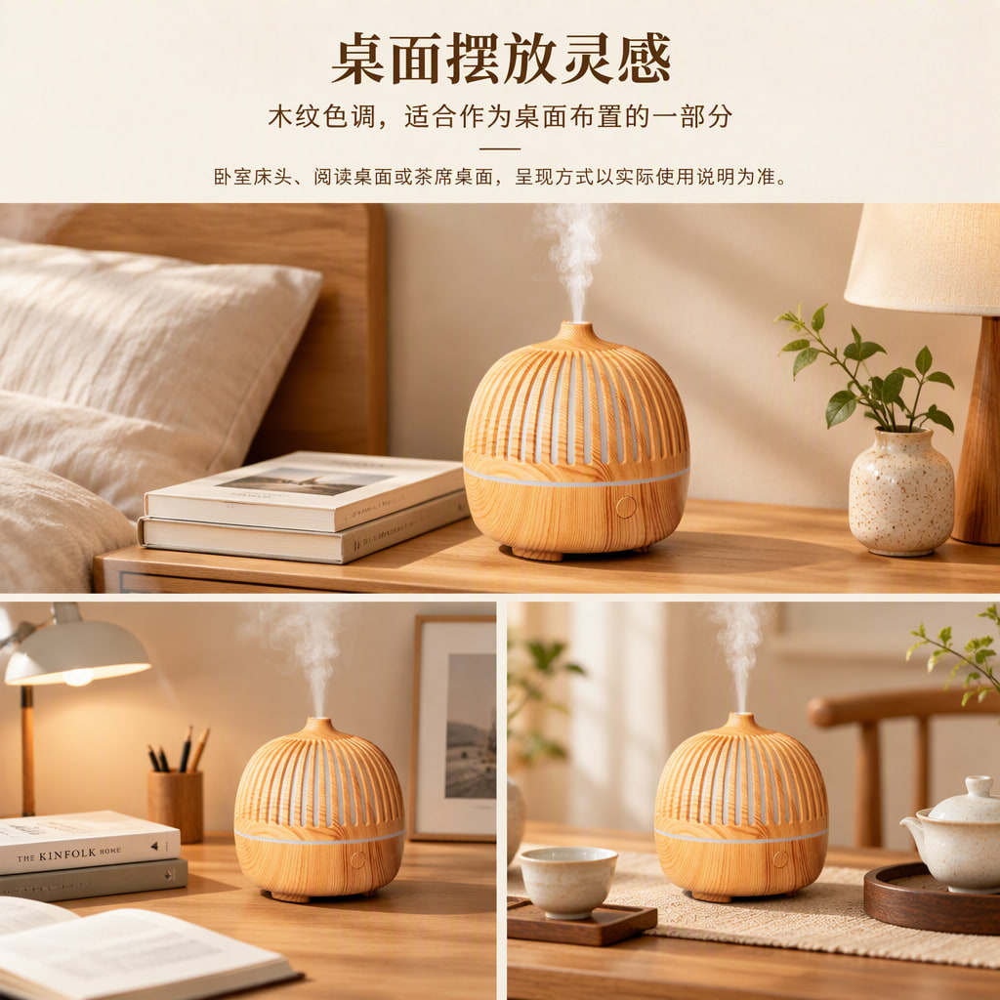
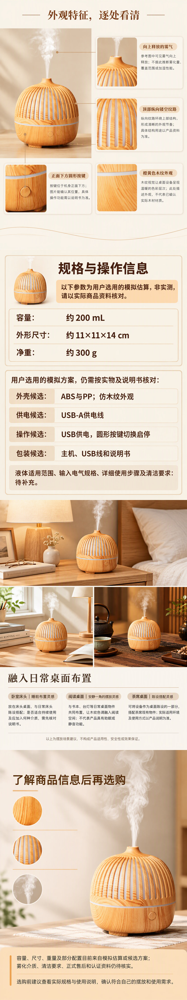

# 木纹外观桌面雾化器

[全部案例](../README.md) · [仓库首页](../../../README.md) · [完整长图](detail-long.jpg)

最新本地生成作品。暖色木纹外观与卧室、书桌布置，4 屏详情包括外观特征、规格与操作、日常场景及选购收尾。

| 规划模型 | 图像模型 | 请求画质 | 头图 / 详情 | 长图尺寸 |
| --- | --- | --- | --- | --- |
| gpt-6-luna | gpt-image-2.5-flare | auto | 3 / 4 | 1080 × 5760 |

## 商品原图

## 全部头图

| 头图 1 | 头图 2 | 头图 3 |
| --- | --- | --- |
|  |  |  |

## 详情页概览

按从左到右、从上到下的顺序阅读。

## 完整详情长图

[打开完整尺寸长图](detail-long.jpg) · 所有详情屏均包含在下图，未拼入头图或手机样机。

## 逐屏查看

| 顺序 | 内容 | 文件 |
| --- | --- | --- |
| 1 | 外观特征，逐处看清 | [查看单屏](detail-1.jpg) |
| 2 | 规格与操作信息 | [查看单屏](detail-2.jpg) |
| 3 | 融入日常桌面布置 | [查看单屏](detail-3.jpg) |
| 4 | 了解商品信息后再选购 | [查看单屏](detail-4.jpg) |

## 来源与检查记录

从本地作品库以只读方式提取该项目当前图片版本（2026-10-17 生成），按编辑器详情顺序拼成长图。精简模型与检查记录见 [generation.json](generation.json)。完整数据库、配置和请求日志未包含在案例中。

整体运行记录为 PARTIAL；整套检查通过不代表所有单图检查均通过。容量、尺寸、重量、材质与供电信息含用户选择的模型推测候选。图中保留当时生成的“模拟”说明，未为 README 改写或擦除文字。

收录日期：2026-10-17。仅等比缩放、压缩与顺序拼接，没有重新生图、补字或局部修图。原图仅用于说明本次生成输入，不代表拥有图中品牌或素材的独占权利。
